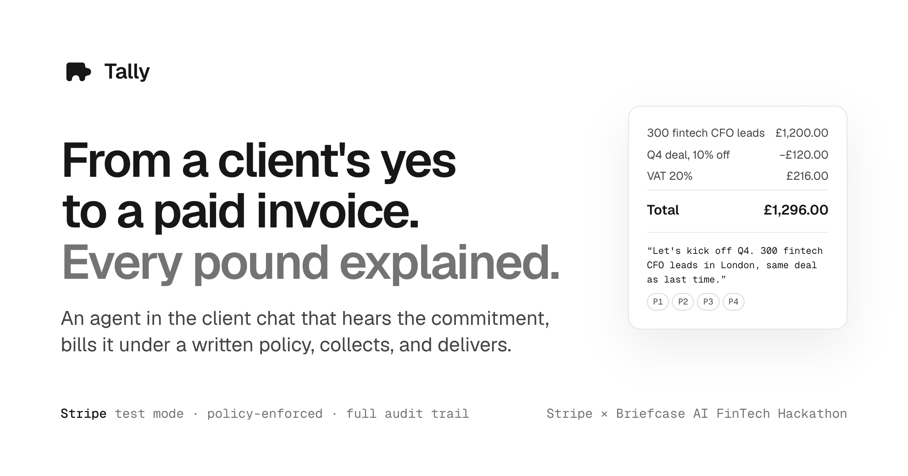

# Tally

> The commit history was squashed before publishing to remove credentials and personal details from the log. Nothing in this tree is secret; use `server/.env.example` for your own test keys.

A billing agent for work agreed in chat. A client writes "300 fintech CFO leads in London, same deal as last time", and Tally recalls the deal, prices it, buys the leads, raises a Stripe invoice with VAT, collects, delivers, and books it. The LLM extracts and explains; code decides and executes under a written policy (`server/policy/billing-policy.md`), and every invoice line cites the quote, the memory fact, and the clause behind it.

Live: https://tally.lnv-louis.workers.dev · Built for the Stripe x Briefcase AI FinTech Hackathon, London, 15 Oct 2026.

Run it: `bun install && cp server/.env.example server/.env && bun run seed && bun run dev`, then open `http://localhost:5173/app/inbox`. Only a Stripe test key (`rk_test_`/`sk_test_`) is required; everything else falls back to local rules and seed data.

Stack: Stripe test mode, OpenAI/Fireworks via the AI SDK, Cognee, Treg, Forme PDF, Hono on Bun with `bun:sqlite`, Vite + React 19 + StyleX, Cloudflare Workers. By Louis and Bulut.
